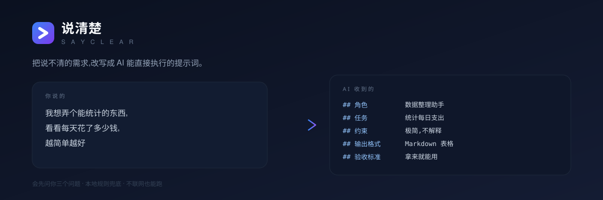

<div align="center">
  
</div>

<p align="center">
  <b>把说不清的需求,改写成 AI 能直接执行的提示词。</b><br />
  <sub>Chrome 扩展 · 零构建 · 零依赖 · 没配模型也能跑</sub>
</p>

<p align="center">
  
  
  
</p>

<p align="center">
  <code>SayClear turns vague, spoken-style requests into structured prompts a model can actually execute — and it stops to ask what you left out.</code>
</p>

---

## 它解决什么问题

大多数人跟 AI 说话是这样的:

> 我想弄个能统计的东西,看看每天花了多少钱,越简单越好

模型只能猜。它不知道你要表格还是要 App,不知道数据从哪来,不知道"简单"是几行还是几页。**结果就是你来回改五遍,还不如一开始说清楚。**

说清楚做的事不是"把话说漂亮",而是三步:

1. **抽出真需求** —— 目标、产出物、给谁看、已经明确的约束;
2. **指出缺口** —— 最多三个"不问就一定会做错"的问题;
3. **写成提示词** —— 精简版(≤120 字)和完整版(角色 / 任务 / 背景 / 约束 / 输出格式 / 验收标准)。

第 2 步是它和一堆"提示词润色器"的唯一实质区别:那些工具帮你把一个句子写得更专业,这个工具会停下来问你——**数据从哪来?要多长?做到什么程度算完成?**

## 怎么用

**方式一:页面内就地改写**(推荐)

在 ChatGPT、Claude、DeepSeek、Gemini、Kimi、豆包、元宝里,选中你自己打的那段糙话 → 浮出 `✦ 说清楚` → 看结果 → 点「填回输入框」。**提示词会原位替换掉你选中的那句**,不会把原话留在框里污染上下文。

**方式二:扩展弹窗**

点工具栏图标,输入(或按 🎤 语音输入,支持中文口述),回车生成。结果可以复制,也可以"填到页面"。

两种方式共用同一套提示词和历史记录(本机保存最近 40 条,点一下就能取回)。

**缺口是可以点的**

「还缺这几个信息」里的每一条都能点「回答」,补一句话就直接重新生成——那句话会变成提示词里的已知条件,模型不会再问你第二遍。这是这个工具唯一闭环的地方:它不是给你一份标准答案,而是把你的需求问清楚。

## 安装

还没上架应用商店,用开发者模式加载(30 秒):

```bash
git clone https://github.com/Luxurylove/sayclear.git
```

1. 打开 `chrome://extensions`
2. 右上角打开 **开发者模式**
3. 点 **加载已解压的扩展程序**,选择仓库根目录(有 `manifest.json` 的那层)
4. 完成。**不配置模型也能用**,见下一节

## 配置模型

点扩展图标 → 右上角 ⚙ → 选服务商 → 保存。任何兼容 OpenAI `/chat/completions` 的接口都能用:

| 服务商 | 接口地址 | 模型名 | Key |
| --- | --- | --- | --- |
| OpenAI | `https://api.openai.com/v1` | `gpt-4o-mini` | 必填 |
| DeepSeek | `https://api.deepseek.com/v1` | `deepseek-chat` | 必填 |
| Ollama(本地) | `http://localhost:11434/v1` | `qwen2.5:7b` | 留空 |
| 中转 / 镜像站 | `https://你的中转站/v1` | 站方文档里写的模型名 | 必填 |
| 自定义 | 你自己的地址 | 任意 | 视情况 |

先澄清一个常见误解:**ChatGPT Plus 订阅不能用来调 API**。网页版是按月付费的聊天产品,API 是另一套东西——要在 `platform.openai.com` 单独建 key 并充值,按 token 计费。如果你用的是中转站,那就用站方发给你的地址和 key。

两个细节:

- **权限是按域名申请的**。第一次保存某个地址时,浏览器会问你"是否允许访问 api.deepseek.com",只申请那一个,不是"所有网站"。这也是 `manifest.json` 里没有写死 `host_permissions` 的原因。
- **Key 只存在本机** `chrome.storage.local`,只有 background 在发请求时用它,页面里拿不到。
- **中转站不需要额外配置**。少数中转不支持 `response_format` 参数、会直接回 400,扩展会自动去掉这个参数重试一次,不用你手动处理。

## 没配模型也能用

第一次装好、还没填 Key 的时候,扩展会走**本地规则模式**:用关键词判断你要表格还是代码、要什么语气、大概多长,拼出一份结构完整的提示词,**不联网、不要 Key、零延迟**。

效果当然不如模型,结果里会明确标着「本地规则」。它的作用是让你在决定要不要填 Key 之前,先看清这个工具到底在做什么。

## 设计说明

这几处是刻意的选择,不是省事:

**为什么分两次调用,而不是一次生成?**
一次生成时模型会急着写提示词,把"理解"跳过去,追问就没了——而追问正是这个工具的价值所在。所以先跑 `intent`(解析意图,输出 JSON),再跑 `compose`(装配提示词),代价是多一次往返。管线在 [`lib/pipeline.js`](lib/pipeline.js),不依赖 `chrome.*`,可以直接在 Node 里测。

**为什么提示词是独立的 `.md` 文件?**
[`prompts/intent.md`](prompts/intent.md) 和 [`prompts/compose.md`](prompts/compose.md) 才是这个项目的核心资产。改一句话的效果,比改一百行 UI 代码大。放在 Markdown 里,它们可读、可以单独拿去用、diff 起来像人话。

**为什么没有构建步骤、没有依赖?**
`manifest.json` 直接指向源码,改完在 `chrome://extensions` 点一下刷新就生效。扩展一共只有 9 个 JS 文件,上构建链的收益远小于"clone 下来就能加载"的收益。

**为什么页面内的 UI 关在 Shadow DOM 里?**
content script 跑在别人家的网页里,普通 DOM 节点会被站点的样式污染(字体、盒模型、`!important` 的重置表)。Shadow DOM 把样式隔开,再用 `pointer-events` 让覆盖层不吃掉页面的点击。

**为什么 API Key 只在 background?**
`background.js` 是唯一的出网口。content script 只负责读选中文字和把结果填回输入框,拿不到 Key,也拿不到设置。

## 项目结构

```
├── manifest.json          # MV3 清单
├── background.js          # 唯一的出网口:调用模型、读写历史
├── lib/
│   ├── pipeline.js        # 两段式管线(意图解析 → 提示词装配)
│   ├── llm.js             # OpenAI 兼容客户端,不引 SDK
│   ├── settings.js        # 默认值、预设、isReady 判断
│   ├── prompts.js         # 读取并填充 prompts/*.md
│   ├── heuristics.js      # 没配模型时的本地规则兜底
│   └── json.js            # 宽容 JSON 解析、截断等小工具
├── prompts/
│   ├── intent.md          # 把口语拆成结构化需求
│   └── compose.md         # 装配成两版提示词
├── content/content.js     # 选中即改写(Shadow DOM)
├── popup/                 # 弹窗工作台
├── options/               # 模型设置
├── scripts/make-icons.py  # 图标是脚本画的,可改色重生成
├── tests/smoke.mjs        # 16 项冒烟测试,零依赖
└── .github/workflows/ci.yml
```

## 开发与测试

```bash
node tests/smoke.mjs          # 冒烟测试,不需要 npm install
python scripts/make-icons.py  # 重新生成图标(需要 Pillow)
```

测试覆盖:JSON 宽容解析、本地规则兜底、`isReady` 判断、两段式管线的调用顺序与数据传递、manifest 里引用的文件是否都存在、提示词占位符与代码是否对得上。最后两项是最容易在迭代里悄悄坏掉的地方。

改完代码在 `chrome://extensions` 点扩展卡片上的刷新按钮:弹窗和设置页下次打开就是新的,但**已经打开的页面必须再刷新一次**——content script 只在页面加载时注入,不会热更新。不刷新的话,页面里那个旧脚本会报 `Extension context invalidated`,这是扩展开发里最常见的一个坑。

## 打包与上架

```bash
# 本地打包(不需要构建工具,也不需要 node_modules)
zip -r sayclear.zip manifest.json background.js lib content popup options prompts icons
```

推到 GitHub 后,CI 每次都会把同样内容的 `sayclear.zip` 作为构建产物上传,可以直接下载。

想上架 Chrome 应用商店的话,提前准备这几样:

- 开发者账号(一次性 $5),以及 1280×800 的截图和商店文案;
- **权限说明要写清楚**:manifest 里 `optional_host_permissions` 写的是 `https://*/*`,这是为了让用户能填任意自定义接口(包括局域网里的 Ollama)。实际行为是**按域名逐个申请**,只在用户点保存时弹一次。审核最容易卡在这里,建议在提交说明里明确写出"用户不配置模型时,扩展不会发出任何网络请求"。
- 隐私政策可以直接用本文档的「隐私」一节改写。

## 已知限制

- **语音输入依赖浏览器的 Web Speech API**,Chrome 需要联网,部分网络环境下会报 `network` 错误。失败时会提示,可以直接打字。
- **页面内改写只在白名单站点运行**,加站点改 `manifest.json` 的 `matches` 再刷新。
- **只用 Chrome MV3 测过**,Firefox 的 `browser.*` 命名空间和后台脚本模型不同,需要单独适配。
- **补答只对本次生成有效**。答案会随这条结果一起存进历史,但不会沉淀成长期偏好;换个说法重新开始,它还是会把该问的再问一遍。
- 完整版提示词里的约束,模型偶尔会补上原文没说的具体数字,`prompts/compose.md` 里已经明确禁止,但没法 100% 保证。

## Roadmap

- [x] 点某条缺口 → 直接追问 → 自动补进提示词(真正闭掉"澄清"这个环)
- [ ] 把补答沉淀成"我的上下文",下次自动带上
- [ ] 按场景分流模板:写代码 / 写文案 / 做图 / 做分析
- [ ] 流式输出,看着提示词长出来
- [ ] 上架 Chrome / Edge 商店,支持一键安装
- [ ] Firefox 适配

## 隐私

- API Key 和生成历史都在本机 `chrome.storage.local`,不上传任何服务器。
- 只读取你**选中**的文字、输入框内容和页面标题,并且只发给你自己配置的模型地址。
- 不收集统计,不注入广告,不请求与功能无关的权限。
- 页面内功能只在 `manifest.json` 列出的 7 个 AI 站点运行。

## License

[MIT](LICENSE)